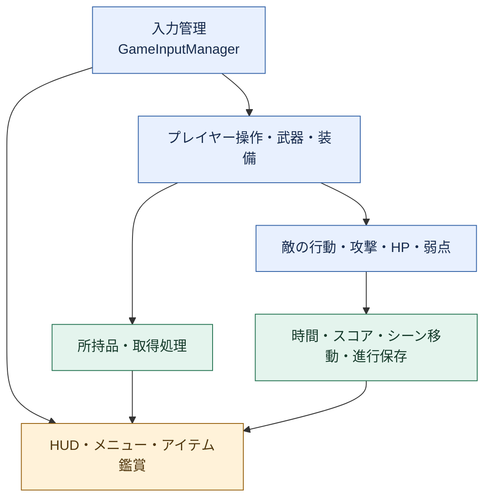
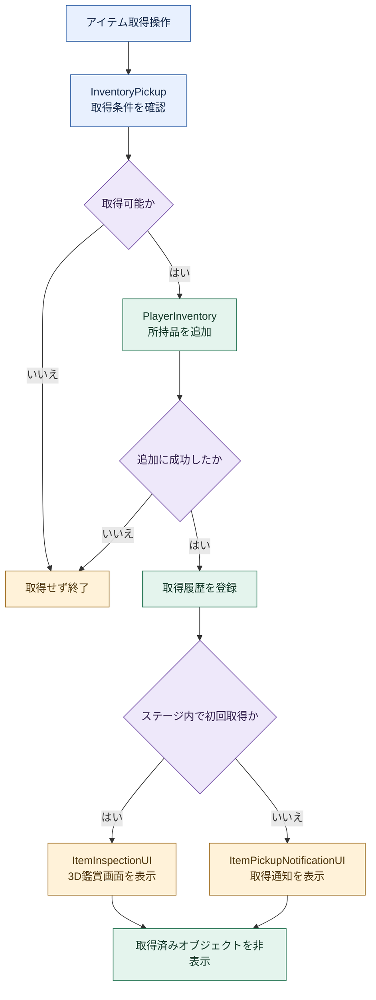
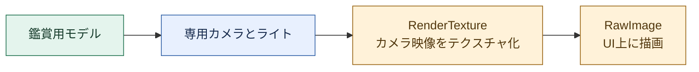

# 🎮 Dead Shot

**開発ポートフォリオ · 松井秀明**

`Unity 2022.3 LTS`　`C#`　`個人開発`　`2026.03〜開発中`

## 🎯 制作コンセプト

**恐怖の中で選んだ攻略が、次に超えたいスコアになる。**

Dead Shotで目指しているのは、**怖さに向き合いながら、自分の判断で攻略を組み立て、その結果を何度も磨きたくなる体験**です。

敵に立ち向かうのか、逃げながらアイテムで切り抜けるのか。同じエリアでも、プレイヤーが選ぶ攻略は一つではありません。クリアしたときに「次は別の方法なら、もっと高い得点を狙える」と感じられることを大切にしています。**リアルな怖さが一つひとつの判断に重みを与え、高得点を目指す楽しさが、もう一度挑む理由になる。** その緊張と挑戦を、区切りのあるプレイで手軽に繰り返せる作品を目指しています。

### 🎮 どのようなゲームか

荒廃してしまった街を舞台に、**指定されたエリアを、より高い得点でクリアすることを目指す、TPS視点のサバイバルホラー型アクションゲーム**です。エリアクリア制を採用し、敵を倒すか、逃げながらアイテムを使うかをプレイヤー自身が選びます。**同じエリアを誰が最も高い得点で突破できるか**を競う楽しさを、ゲーム性の軸に据えています。

### 📖 先へ進みたくなる物語

**「なぜ、この街は荒廃してしまったのか。」**

エリアを攻略するにつれて、街で起きた出来事と荒廃の原因が少しずつ明らかになるシナリオを導入予定です。**高得点を目指して再挑戦する楽しさ**に加え、**真相を知るために先へ進みたい気持ち**が、攻略を続ける動機になる構成を目指しています。

### 🎯 コンセプトを支える3つの軸

| 制作の軸 | 大切にしている体験 |
| :--- | :--- |
| 🕯️ **リアルな怖さ** | 危険を感じるからこそ、立ち向かうか退くかの判断に重みが生まれる |
| 🔄 **繰り返す楽しさ** | 自分なりの攻略を試し、クリア後もさらに高い得点を目指したくなる |
| ⏱️ **プレイの手軽さ** | エリア単位で区切りをつけ、短い機会でも挑戦と再挑戦を楽しめる |

<strong>🔎 コンセプトと実装・設計のつながり</strong>

- **怖さ**：環境音・照明、敵の索敵と追跡、命中部位に応じた反応を組み合わせます。
- **繰り返す楽しさ**：ランダム弱点と装備・アイテムの使い分けで攻略を考える余地を設け、得点を前回の攻略と比較する指標にします。
- **手軽さ**：時間で区切るステージ設計、操作説明、HUD、武器選択、クリア履歴を使った再開処理を整えます。

上記は**制作上の狙い**です。個別の戦闘・アイテム・UI機能を実装しながら、ステージ全体の統合とプレイテストによって、この体験が成立するかを検証していきます。

> [!IMPORTANT]
> **本ページは就職活動用の開発ポートフォリオです。** 担当範囲、設計、処理フロー、改善への取り組みを中心に説明します。PV・画面写真・ゲーム内容は、[ゲーム紹介ページ](docs/GAME_OVERVIEW.md)にまとめています。

> [!NOTE]
> **制作：松井秀明／2026年3月〜現在（開発継続中）**
> 戦闘、アイテム、UI、ステージ移動の基盤を実装しています。4エリアの連続攻略と最終ボス戦は、今後の開発・統合の対象です。

## 🧭 読みたい内容から探す

| 作品と担当を知る | 設計・実装を読む | 確認・補足 |
| :--- | :--- | :--- |
| [📋 開発情報](#development) | [🗺️ システム・フロー図](#architecture) | [🔍 改善事例](#improvements) |
| [🛠️ 担当範囲](#contribution) | [💡 実装上の工夫](#design) | [🚧 開発状況](#status) |
| [⚙️ 主な機能](#features) | [💻 コード一覧](#code) | [🚀 起動手順](#setup) |
| [👤 制作者・Swift開発経験](#author) | [🎯 今後の開発](#roadmap) | [📚 使用素材](#credits) |

---

## 📋 開発情報

| 項目 | 内容 |
| --- | --- |
| 制作者 | **松井秀明** |
| 開発体制 | **個人開発** |
| 開発期間 | **2026年3月〜現在（開発継続中）** |
| エンジン | Unity 2022.3.62f3 |
| 言語 | C# |
| 開発環境 | macOS / Visual Studio Code |
| バージョン管理 | Git / GitHub |
| 状態 | 開発中 |

## 🛠️ 担当範囲と外部素材

個人開発として、**企画、ゲームシステムのプログラミング、UIの実装、シーンへの組込み、ゲームバランスの調整**を担当しています。

| 分野 | 担当内容 |
| --- | --- |
| プレイヤー・戦闘 | 入力制御、武器・弾薬、被ダメージ、回復、装備の連携 |
| 敵 | 行動、攻撃判定、HP、命中部位、弱点表示の実装・調整 |
| UI・進行 | 所持品、取得・鑑賞画面、HUD、ロード、再開情報の管理 |
| 制作支援 | シーンやPrefabの設定を補助するEditor用処理 |

**モデル・アニメーション・音源・フォント等には外部素材を使用しています。**本ページで説明する担当範囲は、これらを用いたゲームシステムの実装・組込みを含みます。素材そのものの制作とは区別し、出典と利用条件を整理しています。

## ⚙️ 現在の主な機能

| 分野 | 主な実装 |
| :--- | :--- |
| 🎯 戦闘 | 射撃・リロード・回復・ローリング・視点切替 |
| 🧟 敵 | 徘徊・追跡・攻撃・部位ダメージ・ランダム弱点 |
| 🎒 アイテム | 所持品管理・取得通知・3D鑑賞・装備とバッテリー |
| 🖥️ UI・進行 | HUD・マップ・導入演出・ロード・項目別保存 |

<strong>📂 機能の詳細を開く</strong>

### 🎯 戦闘・プレイヤー

- 射撃、武器ごとの弾薬管理とリロード
- HP、被ダメージ、回復アイテムの使用
- ローリングと武器選択
- 一人称・三人称に関するカメラ設定と視点切替

### 🧟 敵・攻略要素

- NavMeshを用いた徘徊・追跡、攻撃条件と攻撃判定の管理
- 命中部位に応じたダメージ、部位破壊、被弾・死亡演出
- 敵ごとのランダム弱点と、特殊ゴーグル装備中の弱点表示
- 敵の発見状態に応じた表示・BGMの切替

### 🎒 アイテム・探索

- インベントリ、支給品箱、周囲のアイテム取得
- 初回取得時の3D鑑賞画面と、以降の取得通知
- 鑑賞モデルの回転・ズーム
- フラッシュライト、特殊ゴーグルとバッテリー管理

### 🖥️ UI・進行

- HP、弾薬、スコア、撃破数、残り時間の表示
- マップ、操作説明、ポーズ、キー設定画面
- ニュース・隊長の説明・ヘリコプターを用いた導入処理
- ロード画面を経由するステージ移動
- クリア履歴・着陸地点・カメラ設定などの保存処理

保存対象はクリア履歴・着陸地点・カメラ設定などの項目です。全状態の復元を含むセーブ範囲は、今後の検証・調整で確定します。

## 🚧 ゲームの進行と開発状況

現在のBuild Settingsには、タイトル、ロード、市街地関連シーン、リザルト、Stage1が登録されています。市街地からStage1への移動設定もあります。

> [!IMPORTANT]
> **以下は完成版に向けた開発計画です。** 廃病院、地下鉄、コンビナート、最終ボスステージの4エリアを順に攻略する構成を計画しています。全エリアの連続攻略と最終ボス戦は、今後の開発・統合の対象です。

| エリア | 計画している体験 |
| --- | --- |
| 廃病院 | 狭い廊下や病室で基本操作、弱点、アイテム使用を学ぶ |
| 地下鉄 | 長い射線と狭い通路を使い、戦闘・探索・脱出を判断する |
| コンビナート | 遮蔽物や破壊目標を使った中・長距離戦 |
| 最終ボスステージ | フェーズごとの攻撃や弱点の変化に対応する戦闘 |

タイマーの具体値、ボス出現条件、エリア間の引継ぎは、実装と検証に合わせて確定します。

---

## 🗺️ システム構成と処理フロー

**図の色分け：青＝操作・処理／緑＝データ・状態／黄＝表示・終了／紫＝条件分岐。**

以下の図は、主要な責務と処理の流れを説明するために簡略化しています。すべてのクラス間依存やメソッド呼出しを網羅したものではありません。

### 🧩 主要システムの役割

入力管理で操作状態に応じた入力を提供し、プレイヤー・武器などの処理へつなぎます。敵、アイテム、ゲーム進行は役割を分け、状態や結果をUIへ反映します。図中の矢印は、処理・情報が伝わる方向を表します。

### 📦 アイテム取得から表示まで

通常アイテムの取得処理を示しています。所持品への追加に成功してから取得履歴を判定することで、取得できなかった場合に鑑賞画面だけが表示されることを避けています。初回はモデルを回転・ズームできる鑑賞画面、それ以降は通知を表示します。支給品箱は別の取得処理から各報酬を扱います。

### 🖼️ 3DモデルをUIに表示する仕組み

ゲーム内のアイテムを鑑賞用に複製し、専用カメラで描画した映像をUIへ重ねます。モデルの表示位置や回転を、通常のゲーム空間とは分けて調整できる構成です。鑑賞画面を開く際には専用ライトを有効化し、無効状態で保存されていた場合も照明を復帰させます。

## 💡 実装上の工夫

### 🎮 状況に応じた入力の切替

`GameInputManager`でキーボード・コントローラーの入力を扱い、ゲーム操作、会話、メニュー、武器選択などの状態に応じて入力を制御しています。画面を切り替えた直後の意図しない決定や、メニュー操作と射撃の競合を抑える構成です。

### 🧩 敵の状態と攻撃処理の分離

`EnemyManager`が移動・行動、`EnemyAttack`が攻撃開始と判定期間、`EnemyHealth`がダメージ・死亡、`EnemyWeakPoint`が弱点を担当します。機能ごとの調整箇所を分けています。

### 📦 取得と鑑賞を分けたアイテムUI

`PlayerInventory`で所持数と取得履歴を管理し、`InventoryPickup`から初回取得時の`ItemInspectionUI`と通常の取得通知を呼び分けています。鑑賞画面は専用カメラとRenderTextureを使い、3DモデルをUI上に表示します。

### 🛠️ 調整用データとEditor補助

ダメージ設定や音源設定をデータとして管理し、Editor用のセットアップ処理でシーン・Prefabの設定作業を補助しています。

## 💻 主なコード

コードは主に `Assets/Game/S_Scripts/`、セットアップ用コードは `Assets/Game/Editor/` 等にあります。

<strong>📂 クラスと役割の一覧を開く</strong>

| クラス | 主な役割 |
| --- | --- |
| GameInputManager | 入力の取得と操作状態の制御 |
| WeaponAmmoSystem | 武器ごとの弾薬・発射可否・リロード |
| EnemyManager / EnemyAttack | 敵の行動・移動と攻撃判定 |
| EnemyHealth / EnemyWeakPoint | ダメージ・部位・弱点 |
| PlayerInventory / InventoryPickup | 所持品・取得履歴・取得処理 |
| ItemInspectionUI | 取得時の3D鑑賞画面 |
| ScoreAndTimeManager | スコア・時間・終了条件 |
| StageTransitionTrigger | ステージ移動の開始 |
| GameProgressData | クリア履歴・再開情報 |

## 🚀 開発環境での起動

1. GitとGit LFSを用意し、リポジトリを取得します。
2. `git lfs pull` でLFS管理のファイルを取得します。
3. Unity Hubからプロジェクトを追加し、Unity 2022.3.62f3で開きます。
4. `Assets/Game/S/Title2.unity` を開いて再生します。

起動手順は開発環境での利用を想定しています。新規取得環境での動作と、配布ビルドの対応OS・動作環境は検証を進めています。

---

## 🔍 改善事例と確認方針

| 課題 | 対応 | 確認状況・次の確認 |
| --- | --- | --- |
| 取得したアイテムの鑑賞モデルが暗い | 専用ライトが無効だったことを踏まえ、画面を開く際にLightとGameObjectを有効化する処理を追加 | コード差分確認済み。取得操作を通した再生確認が必要 |
| 多数の入力が画面ごとに競合する | 入力管理で会話・メニュー・武器選択等の状態を扱う | 画面遷移、キー割当変更、コントローラー使用時を継続確認 |
| 全体進行の完成と個別機能の実装が混同される | 既存機能と4エリアの開発計画を区別 | 全エリアの通しプレイと配布環境での検証が今後の課題 |

改善結果は、実際に確認できた範囲を記載します。性能値や通しプレイの成功回数は、測定・検証を行った段階で追記します。

## 🎯 今後の開発

- 4エリアの進行、クリア条件、再挑戦を統合する
- エリアボスと最終ボスの戦闘を実装・調整する
- エリア間でのHP・弾薬・所持品の引継ぎルールを確定する
- 既存の保存・コンティニュー処理を検証し、再開できる範囲を明確にする
- 難易度、視認性、音量、描画負荷を調整する
- 配布ビルド、プレイ動画、スクリーンショット、操作説明を整える

## 📚 使用素材・クレジット

外部のモデル、アニメーション、音源、フォント等を使用しています。各素材の制作者・入手元・ライセンス・必要なクレジットは、確認後に一覧化します。

---

## 👤 制作者

**松井秀明**

**所属：創価大学大学院 修士1年**

大学院でVR・XRに関する研究に取り組みながら、Unityを用いたゲーム開発やソフトウェア開発を行っています。

### 📱 その他の開発経験

**Swiftを用いた、iPhoneで動作するオリジナル辞書アプリの開発経験**があります。ゲーム以外にも、モバイル端末上で利用するアプリケーションの制作に取り組んでいます。

**配信状況：未配信（App Store等での公開なし）**
